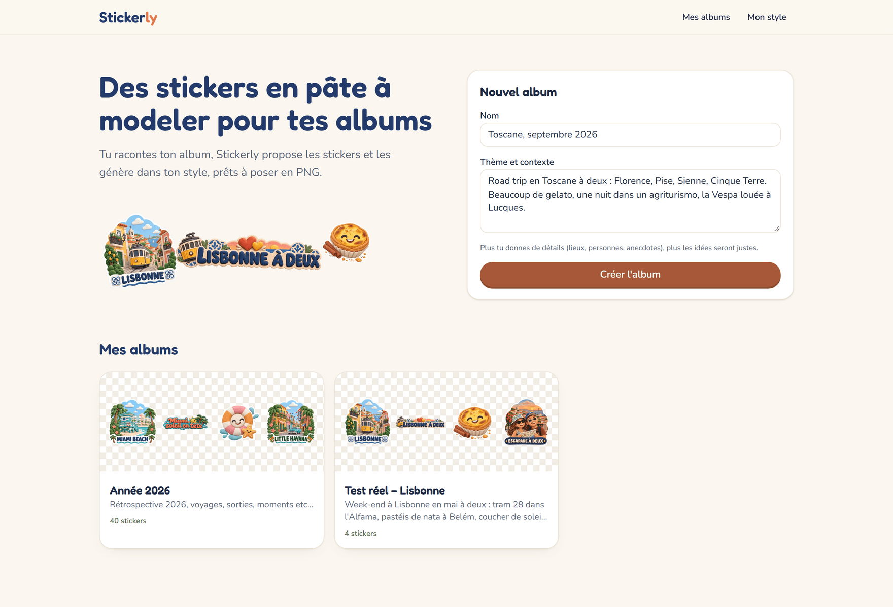
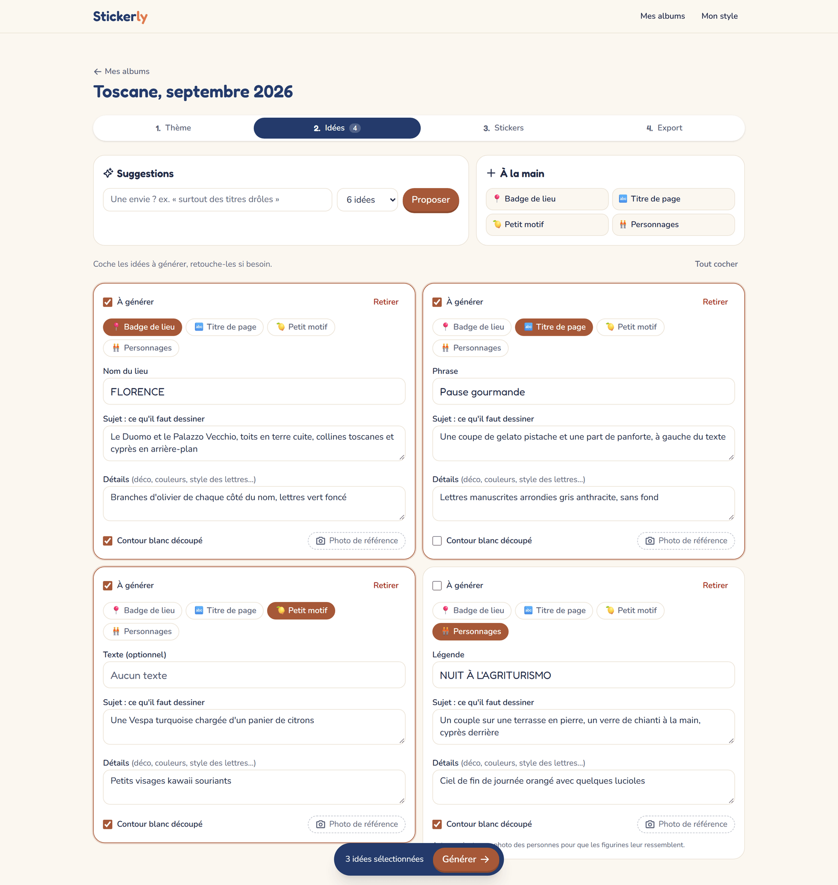
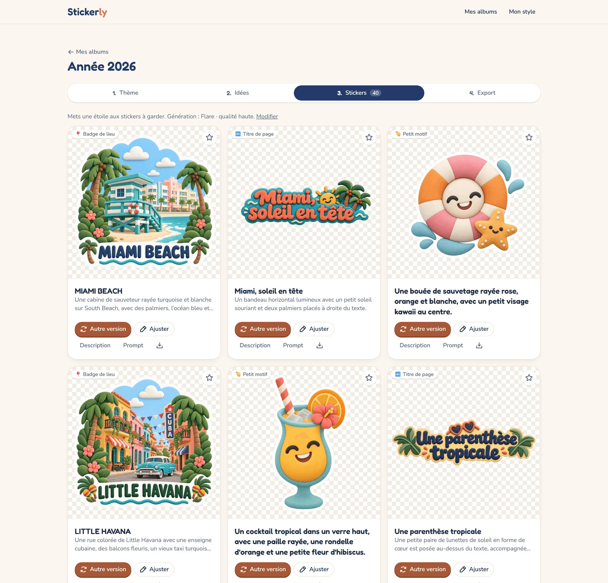

<div align="center">


# Stickerly

**Des stickers en pâte à modeler pour illustrer tes albums photo, toujours dans le même style.**



</div>

Illustrer un album photo avec des stickers générés, c'est vite pénible : on réécrit le même prompt, on le retouche, on relance, on compare. Stickerly fait ce travail à ta place. Tu décris ton album, l'app propose des stickers, les génère dans **ton** style et te laisse les ajuster en une phrase.

Tout tourne en local, avec ta clé OpenAI. Les images sortent en PNG à fond transparent, prêtes à poser dans ton logiciel d'album ou à imprimer sur du papier autocollant.

## Fonctionnalités

- **Parcours guidé en 4 étapes** : thème → idées → génération → export.
- **Bibliothèque de styles** : plusieurs styles, chacun avec sa description, ses exemples et son modèle. L'album en choisit un, et un sticker peut en prendre un autre.
- **Suggestions d'idées** adaptées au thème de l'album (lieux visités, plats, anecdotes).
- **Depuis une image** : une photo, une capture, un dessin. Tu choisis le type de sticker, l'image est lue pour remplir la description et sert de référence — le sticker est redessiné dans ton style, jamais collé tel quel.
- **Prompt dynamique** : ton style, la mise en page du type de sticker et ta description sont assemblés automatiquement. Tu peux toujours lire et modifier le prompt final.
- **Cohérence de style** : jusqu'à 3 des exemples du style sont joints à chaque génération comme références visuelles.
- **Retouches en une phrase** : « plus simple », « texte plus gros », « sans contour blanc »… sans repartir de zéro.
- **Historique des versions** : chaque sticker garde toutes ses versions, tu choisis celle à garder.
- **Photos de référence** : pour que les figurines ressemblent vraiment aux personnes.
- **Export** : zip des favoris ou de tout l'album, en PNG transparents.
- **Coût affiché** pour chaque génération et pour l'album entier.

## Prérequis

- [Node.js](https://nodejs.org) 20.9 ou plus récent
- Une clé API [OpenAI](https://platform.openai.com/api-keys), sur un compte avec du crédit

## Démarrage

```bash
npm install
```

Crée un fichier `.env.local` à la racine (tu peux copier `.env.example`) :

```ini
OPENAI_API_KEY=sk-...
```

Puis lance le serveur :

```bash
npm run dev
```

L'app est sur http://localhost:3000.

> [!TIP]
> Pour découvrir l'interface sans dépenser un centime, ajoute `STICKERLY_FAKE_AI=1` dans `.env.local` : l'app renvoie tes images de référence au lieu d'appeler OpenAI.

## Comment ça marche

1. **Thème** — tu racontes l'album : lieux, personnes, moments forts, anecdotes. Plus c'est détaillé, plus les idées sont justes.
2. **Idées** — le bouton « Proposer » suggère des stickers adaptés. Tu peux aussi en ajouter à la main, ou partir d'une de tes images : choisis le type, puis l'image, et « Convertir en sticker » enchaîne directement sur la génération. Tu coches les idées à générer, après les avoir retouchées si besoin.
3. **Stickers** — la génération part par lots de 3 en parallèle. Sur chaque sticker : « Autre version » relance, « Ajuster » applique une consigne courte, l'étoile garde le sticker en favori.
4. **Export** — tu télécharges tes favoris, ou tout l'album, en un zip.

<p align="center">
  
  <br>
  <em>Étape 2 : chaque idée est modifiable avant de partir en génération.</em>
</p>

<p align="center">
  
  <br>
  <em>Étape 3 : « Autre version » relance, « Ajuster » applique une consigne courte, l'étoile garde le sticker.</em>
</p>

## Les types de stickers

| Type | À quoi ça sert | Exemple | Format |
| --- | --- | --- | --- |
| 📍 Badge de lieu | Vignette souvenir d'un lieu, avec son nom en bas | Florence, Porto, Giverny | 1248 × 1248 |
| 🔤 Titre de page | Bandeau horizontal : une phrase et une illustration | « Pause gourmande » | 2112 × 720 |
| 🍋 Petit motif | Un ou deux objets décoratifs, sans texte | Citron et glace, nénuphars | 1024 × 1024 |
| 🧑‍🤝‍🧑 Personnages | Les gens de l'album en figurines | « Éclipse à deux » | 1248 × 1248 |

Chaque type a sa propre mise en page dans le prompt : composition, place du texte, décor autour du nom.

Cette mise en page ne dépend pas du style : le **type** décide de la composition, le **style** décide du rendu.

## Tes styles

Un **style**, c'est une manière de rendre un sticker : sa matière, sa lumière, sa palette, son lettrage. La page **Mes styles** en tient la bibliothèque. Chacun porte :

- **Sa description** (matière, lumière, palette, lettrage), ajoutée à chaque prompt — et qui sert aussi à rédiger les suggestions d'idées.
- **Son modèle** d'image, et la **qualité** d'où partent ses générations.
- **Ses exemples de référence** : les images de son dossier `references/<style>/`, que tu classes par type. À chaque génération, jusqu'à 3 exemples du même type sont tirés au hasard et joints au prompt. C'est le plus efficace pour garder un rendu cohérent.

Pour ajouter des exemples, dépose des PNG dans le dossier du style, puis indique leur type sur sa page.

**Quel style s'applique ?** Celui du sticker s'il en a un, sinon celui de l'album, sinon le style par défaut. L'album choisit le sien à l'étape **Thème** — avant les idées, puisque le style sert aussi à les écrire. Un sticker en prend un autre depuis son panneau « Prompt ».

Le dossier d'un style garde son nom même si tu le renommes, pour ne pas réécrire les albums et les versions qui le citent. Supprimer un style ne supprime pas son dossier d'images.


> [!NOTE]
> Si un type n'a qu'un seul exemple, le modèle a tendance à en recopier des éléments (un accessoire, un décor). Deux ou trois exemples par type suffisent à éviter ça.

## Les photos de référence

Sur n'importe quel sticker, tu peux joindre jusqu'à 4 photos. Elles servent à la **ressemblance** : visage, cheveux, couleur de peau, lunettes, barbe. La tenue, la pose, les accessoires et le décor suivent ta description dès que tu les précises, même si la photo montre autre chose.

## Modèles et coûts

| Usage | Modèle | Ordre de grandeur |
| --- | --- | --- |
| Images | `gpt-image-2.5-flare` (défaut) ou `gpt-image-2.5-sunburst` | 0,06 à 0,10 $ par sticker en qualité haute, 0,03 $ par retouche |
| Idées | `gpt-5.6-luna` | négligeable |

Le coût estimé de chaque version est affiché dans le panneau « Prompt » du sticker, et le total de l'album dans l'étape « Export ». Compte 15 à 40 secondes par image.

> [!TIP]
> La qualité « Brouillon » permet de tester une idée pour quelques centimes, avant de relancer la bonne en qualité haute. Chaque style a sa qualité de départ, et le sélecteur en haut de l'album la change le temps de la session.

## Configuration

| Variable | Rôle |
| --- | --- |
| `OPENAI_API_KEY` | Ta clé API OpenAI. Obligatoire. |
| `OPENAI_TEXT_MODEL` | Modèle texte des suggestions d'idées. Par défaut `gpt-5.6-luna`. |
| `STICKERLY_FAKE_AI` | À `1`, mode démo sans aucun appel à OpenAI. |

Le reste (styles, modèles d'image, qualité, exemples) se règle dans l'app, page « Mes styles ».

## Structure du projet

```
app/
  page.tsx              Accueil : liste des albums
  albums/[id]/          Espace de travail d'un album
  styles/               Bibliothèque de styles, et l'éditeur de chacun
  api/                  Routes : albums, idées, génération, photos, export, styles
components/             Interface (workspace, cartes, formulaires, styles)
lib/
  types.ts              Le vocabulaire du domaine, et la résolution du style
  prompt.ts             Construction du prompt : style + type de sticker + description
  ai.ts                 Appels OpenAI (images et idées) et estimation des coûts
  storage.ts            Stockage local des albums, images et styles
  image.ts              Nettoyage de la transparence des PNG
references/<style>/     Les exemples de chaque style
scripts/                Migration one-shot vers la bibliothèque de styles
docs/adr/               Les décisions d'architecture et leurs raisons
data/                   Albums, images générées, photos, styles (ignoré par git)
```

Le vocabulaire du projet — album, sticker, type, version, style, exemple de référence — est défini dans [GLOSSARY.md](GLOSSARY.md).

## Mise à jour depuis une version sans bibliothèque de styles

Les réglages globaux « Mon style » sont devenus un premier style, « Pâte à modeler ». Une migration one-shot replie l'ancienne configuration, déplace les exemples de `references/` vers `references/pate-a-modeler/` et estampille les albums existants :

```bash
npm run migrate:styles -- --dry-run   # montre ce qui serait fait
npm run migrate:styles                # applique
```

Elle utilise `git mv` pour les images que git suit, afin que leur historique les suive, et elle est idempotente. `data/settings.json` n'est plus lu ; elle le laisse en place, à toi de le supprimer.

## Dépannage

> [!IMPORTANT]
> **« Clé OpenAI manquante »** : vérifie que `.env.local` existe à la racine, contient `OPENAI_API_KEY=sk-...`, puis relance `npm run dev`.

- **« Refusé par la modération »** : une formulation a déplu au filtre d'OpenAI. Reformule le sujet ou la légende, souvent un mot suffit.
- **« Limite OpenAI atteinte »** : trop de générations d'affilée, ou crédit épuisé. Attends un peu, ou vérifie le solde de ton compte.
- **Le texte du sticker est mal orthographié** : relance avec « Autre version », ou utilise « Ajuster » en citant la correction exacte.
- **Un élément d'un autre sticker apparaît** : le modèle a recopié un exemple de référence. Ajoute d'autres exemples de ce type au style concerné.

> [!WARNING]
> Tout est stocké dans `data/`, sur ta machine, sans authentification. L'app est pensée pour tourner en local : ne la déploie pas telle quelle sur Internet.
